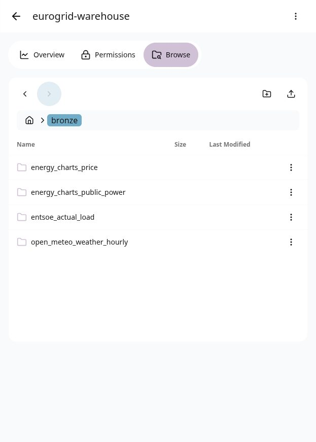
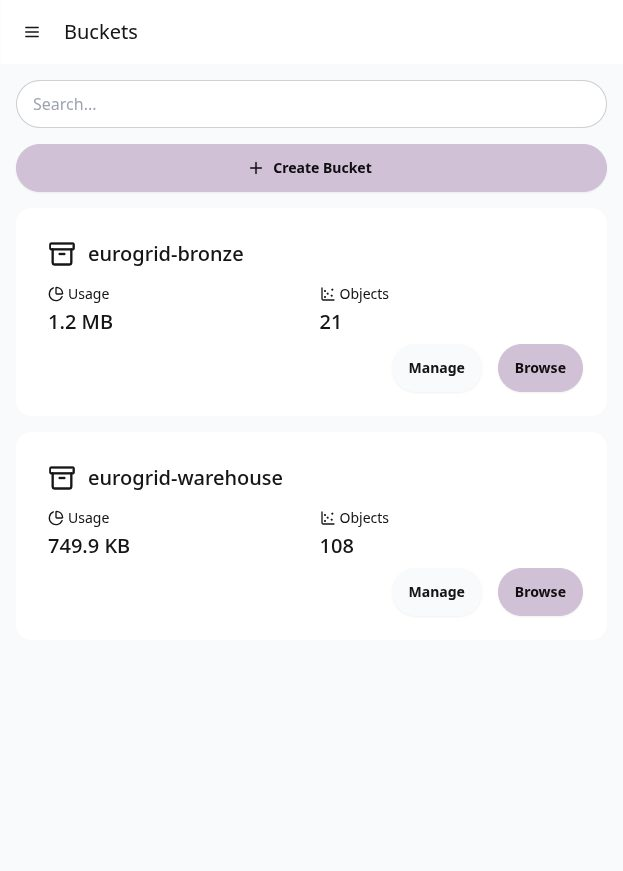
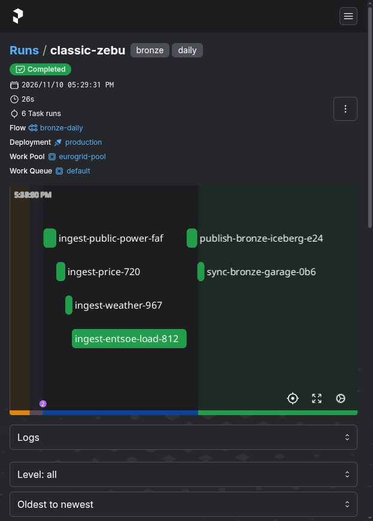

# Bukti Increment 4: ENTSO-E, Katalog Postgres, dan Tabel Bronze di Garage

Tanggal: 2026-11-10

Increment ini menutup tiga pekerjaan Platform dan Storage yang tersisa:
sumber ENTSO-E, backend katalog Iceberg di Postgres, dan tabel Bronze yang
benar-benar dapat dibaca dari Garage. Dengan ini lapisan Silver bisa dimulai.

## Lingkungan

- Podman 6.1.4 dengan `podman-compose`.
- Image katalog `localhost/eurogrid-iceberg-rest:latest`, diturunkan dari
  `apache/iceberg-rest-fixture:1.10.1`.
- Postgres 16, database `iceberg`, volume `pg-data`.
- PyIceberg 0.12.0 dan PyArrow 26.0.1.
- Prefect 3.9.2, worker image `localhost/eurogrid-prefect-worker:latest`.

## 1. Sumber ENTSO-E

Token ENTSO-E sudah aktif. Permintaan uji memakai:

```
documentType=A65
processType=A16
outBiddingZone_Domain=10Y1001A1001A82H
periodStart=202611030000
periodEnd=202611100000
```

Hasil: HTTP 200, 86.606 byte XML, satu `TimeSeries` dengan resolusi `PT15M`
dan satuan `MAW`.

Ingest lewat CLI menghasilkan batch:

| Field | Nilai |
| --- | --- |
| Batch ID | `aecfc803b387bdf0` |
| Baris | 672 |
| Partisi | `country=de/bzn=10Y1001A1001A82H` |
| Dataset | `actual_load` |

Ingest kedua dengan rentang sama menghasilkan `created: false` dan batch ID
yang sama. Token tidak tersimpan di `metadata.json`; parameter `securityToken`
tertulis sebagai `***`. Field dokumen yang berubah setiap panggilan, yaitu
`mRID`, `revisionNumber`, dan `createdDateTime`, tidak ikut dihitung dalam
checksum.

Contoh baris:

```text
timestamp_utc            series_id       value unit
2026-11-03 00:00:00+00:00         1 48871.07331  MAW
2026-11-03 00:15:00+00:00         1 48936.75403  MAW
2026-11-03 00:30:00+00:00         1 48557.17269  MAW
```

## 2. Katalog Iceberg di Postgres

Image bawaan `apache/iceberg-rest-fixture` membawa `JdbcCatalog` tetapi tidak
membawa driver Postgres. `infra/iceberg/Dockerfile` menambahkan
`postgresql-42.7.4.jar` ke `/opt/jdbc`, lalu container dijalankan dengan:

```bash
java -cp /usr/lib/iceberg-rest/iceberg-rest-adapter.jar:/opt/jdbc/postgresql-42.7.4.jar \
     org.apache.iceberg.rest.RESTCatalogServer
```

Properti katalog yang dipakai:

| Env | Properti Iceberg | Nilai |
| --- | --- | --- |
| `CATALOG_CATALOG__IMPL` | `catalog-impl` | `org.apache.iceberg.jdbc.JdbcCatalog` |
| `CATALOG_URI` | `uri` | `jdbc:postgresql://postgres:5432/iceberg` |
| `CATALOG_JDBC_USER` | `jdbc.user` | `eurogrid` |
| `CATALOG_JDBC_PASSWORD` | `jdbc.password` | dari `.env` |
| `CATALOG_WAREHOUSE` | `warehouse` | `s3://eurogrid-warehouse/` |

Tabel katalog yang terbentuk di Postgres:

```text
 public | iceberg_namespace_properties
 public | iceberg_tables
```

Isi `iceberg_tables` setelah publish:

```text
 table_namespace |         table_name
-----------------+----------------------------
 bronze          | energy_charts_price
 bronze          | energy_charts_public_power
 bronze          | entsoe_actual_load
 bronze          | open_meteo_weather_hourly
```

Persistensi diuji dengan menghapus container `eurogrid-iceberg-rest` lalu
membuatnya ulang. Keempat tabel tetap ada dan `bronze.entsoe_actual_load` tetap
terbaca 672 baris. Ini berbeda dari tahap sebelumnya, ketika metadata katalog
hilang karena tersimpan di SQLite dalam container.

## 3. Tabel Bronze di Garage

Perintah `eurogrid publish-iceberg` menggabungkan seluruh batch lokal per
dataset, membuang duplikat berdasarkan `series_id` dan `timestamp_utc`, lalu
menulis ulang tabel Iceberg.

| Tabel | Baris | Lokasi |
| --- | --- | --- |
| `bronze.energy_charts_public_power` | 16.128 | `s3://eurogrid-warehouse/bronze/energy_charts_public_power` |
| `bronze.energy_charts_price` | 768 | `s3://eurogrid-warehouse/bronze/energy_charts_price` |
| `bronze.open_meteo_weather_hourly` | 768 | `s3://eurogrid-warehouse/bronze/open_meteo_weather_hourly` |
| `bronze.entsoe_actual_load` | 672 | `s3://eurogrid-warehouse/bronze/entsoe_actual_load` |

Menjalankan publish dua kali tidak menambah baris. Di Garage terdapat 20 objek
di prefix `bronze/` dengan total 159.582 byte, terdiri dari berkas Parquet,
metadata JSON, dan manifest Avro.



## 4. Arsip batch mentah di bucket Bronze

`eurogrid sync-bronze` menyalin isi `data/bronze` ke `s3://eurogrid-bronze/bronze/`.
Hasilnya 21 berkas dan 1.208.421 byte, mencakup `raw.json`, `data.parquet`, dan
`metadata.json` untuk setiap batch.



## 5. Flow Prefect

Deployment `bronze-daily/production` sekarang menjalankan enam task:

1. `ingest-public-power`
2. `ingest-price`
3. `ingest-weather`
4. `ingest-entsoe-load`
5. `publish-bronze-iceberg`
6. `sync-bronze-garage`

Run `classic-zebu` selesai dalam keadaan `Completed` dalam 26 detik. Keempat
task ingest selesai, publish menulis empat tabel, dan arsip menyalin 21 berkas.
Run berikutnya dengan rentang sama menghasilkan `0 batch baru` dan jumlah baris
tabel yang sama.



## 6. Uji otomatis

```text
29 passed
```

Uji baru pada increment ini:

- `tests/test_entsoe.py`: parameter periode UTC, parse XML, tabel panjang,
  ketiadaan field volatil, ingest idempoten, penyuntingan token, dan penolakan
  saat token kosong.
- `tests/test_warehouse.py`: nama tabel dan penggabungan batch dengan dedup.

## Batasan tahap ini

- ENTSO-E baru memakai `actual_load`. Harga day-ahead masih diambil dari
  Energy-Charts. Penambahan `A44` atau aliran lintas negara dapat memakai
  kerangka yang sama.
- Publish Iceberg menulis ulang seluruh tabel, bukan append incremental. Volume
  Bronze masih kecil, tetapi cara ini perlu diganti saat data bertambah besar.
- Image katalog bawaan mencetak seluruh properti katalog, termasuk kata sandi
  Postgres dan secret S3, ke log container. Untuk mesin lokal ini masih dapat
  diterima, tetapi log tidak boleh dibagikan tanpa penyaringan.
- Server Prefect masih memakai SQLite. Yang sudah pindah ke Postgres adalah
  katalog Iceberg.
- Silver, Gold, Trino, Redpanda, ML, API, dashboard, dan observability belum
  dikerjakan.