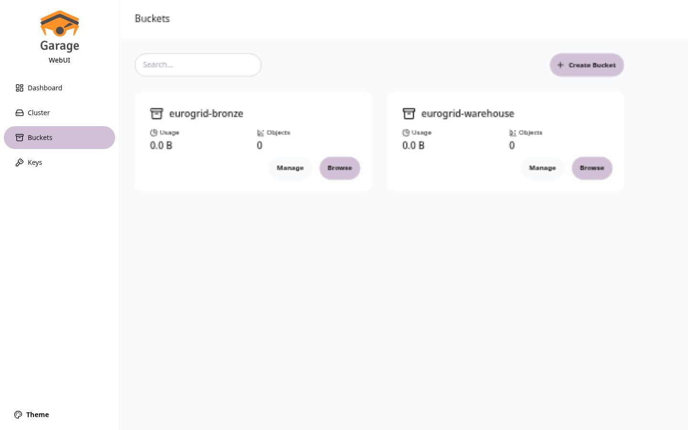
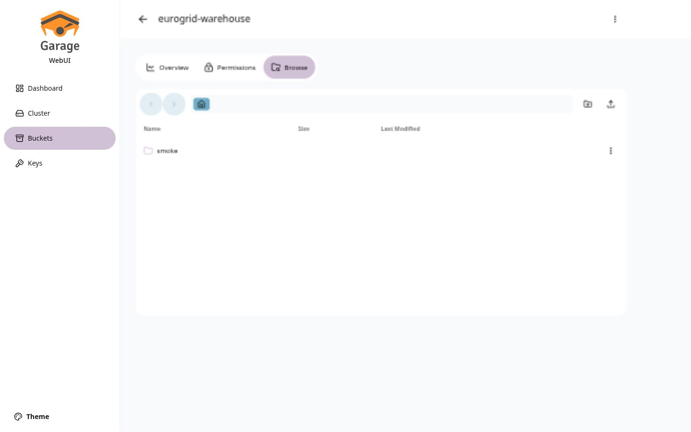

# Bukti Increment 2: Garage S3, Web UI, dan Smoke Test Iceberg

Tanggal: 2026-11-10

## Lingkungan

- Podman dengan `podman-compose`.
- Garage `dxflrs/garage:v2.5.0`, satu node, `--single-node`.
- Garage Web UI `khairul169/garage-webui:1.1.0`, hanya bind ke `127.0.0.1:3909`.
- Katalog Iceberg REST `apache/iceberg-rest-fixture:1.10.1`.

## Port yang dipakai

| Port | Layanan | Bind |
| --- | --- | --- |
| 3900 | Garage S3 API | semua antarmuka |
| 3903 | Garage Admin API | semua antarmuka |
| 3909 | Garage Web UI | `127.0.0.1` |
| 8181 | Iceberg REST | semua antarmuka |

## Hasil penyiapan Garage

- Node `1449b4ce59646037` berstatus sehat, kapasitas 1,3 TiB.
- Bucket `eurogrid-warehouse` dan `eurogrid-bronze` dibuat.
- Key `eurogrid-app` punya izin RW pada kedua bucket.
- Kredensial S3 dipindah dari `compose.yaml` ke `.env` dengan mode 600.
- `admin_token` dan `metrics_token` di `infra/garage/garage.toml` diganti nilai
  acak yang sebenarnya.

## Verifikasi melalui Web UI

Halaman `http://127.0.0.1:3909` menampilkan:

- Dashboard: status `Healthy`, 1 node, 256 partisi aktif.
- Buckets: `eurogrid-bronze` dan `eurogrid-warehouse` beserta ukuran dan jumlah
  objek.
- Keys: `eurogrid-app` aktif dan dapat dilihat detailnya.
- Browse bucket `eurogrid-warehouse`: folder `smoke` berisi berkas metadata dan
  data Iceberg.





## Smoke test Iceberg

Perintah:

```bash
uv run --extra iceberg python scripts/iceberg_smoke.py
```

Alur yang diuji: buka katalog REST, buat namespace `smoke`, buat tabel
`smoke.prices`, tulis 3 baris, lalu baca kembali.

```text
katalog     : eurogrid
tabel       : smoke.prices
lokasi      : s3://eurogrid-warehouse/smoke/prices
baris dibaca: 3
isi         : [{'ts': 2025-11-10 00:00, 'zone': 'DE-LU', 'price_eur_mwh': 86.4},
               {'ts': 2025-11-10 01:00, 'zone': 'DE-LU', 'price_eur_mwh': 91.2},
               {'ts': 2025-11-10 02:00, 'zone': 'FR', 'price_eur_mwh': 74.8}]
```

Setelah pengujian, bucket `eurogrid-warehouse` berisi 11 objek dengan ukuran
20,6 kB. Ini membuktikan tulisan metadata dan data benar-benar sampai ke Garage,
bukan hanya tersimpan di katalog.

Catatan teknis:

- `AWS_REGION` dan `AWS_DEFAULT_REGION` perlu diisi `garage` pada container
  katalog. Tanpa itu, AWS SDK gagal menentukan region saat menulis metadata.
- `AWS_REQUEST_CHECKSUM_CALCULATION=when_required` mencegah ketidakcocokan
  checksum CRC32 pada S3 yang kompatibel.

## Batasan tahap ini

- Katalog masih memakai SQLite di dalam container, jadi metadata katalog hilang
  bila container dibuat ulang. Untuk produksi perlu PostgreSQL.
- Belum ada Trino, Prefect, Redpanda, dan lapisan serving.
- ENTSO-E masih menunggu aktivasi token; permintaan mengembalikan HTTP 401.
- Data smoke test masih ada di namespace `smoke`. Hapus dengan
  `uv run --extra iceberg python scripts/iceberg_smoke.py --drop`.
