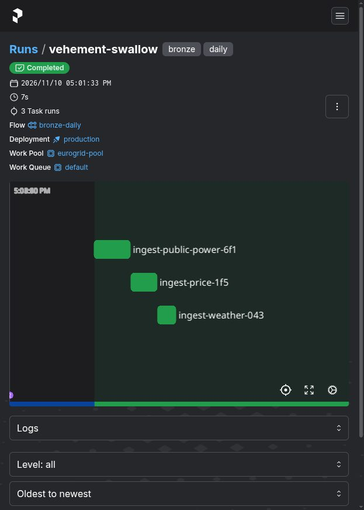

# Bukti Increment 3: Deployment Prefect

Tanggal: 2026-11-10

## Lingkungan

- Podman 6.1.4 dengan `podman-compose`.
- Prefect 3.9.2, image `prefecthq/prefect:3-python3.12`.
- Image worker dibangun dari `infra/prefect/Dockerfile`.
- Server Prefect di port `4200`, metadata di volume `prefect-data`.

## Komponen

| Komponen | Peran |
| --- | --- |
| `eurogrid-prefect-server` | API dan UI Prefect |
| `eurogrid-prefect-worker` | Menjalankan flow dari work pool `eurogrid-pool` |
| `flows/bronze_daily.py` | Flow harian dengan tiga task |
| `prefect.yaml` | Definisi deployment dan jadwal |

Deployment yang terdaftar bernama `bronze-daily/production` dengan konfigurasi:

- Entrypoint `flows/bronze_daily.py:bronze_daily`
- Work pool `eurogrid-pool`, tipe process
- Parameter bawaan `days=7`
- Jadwal cron `0 5 * * *` zona `Europe/Berlin`, aktif
- Tag `bronze` dan `daily`

## Perintah yang dijalankan

```bash
podman build -t localhost/eurogrid-prefect-worker:latest -f infra/prefect/Dockerfile .
make prefect-up
make prefect-run
```

`infra/prefect/entrypoint.sh` menunggu API sehat, membuat work pool bila belum
ada, menjalankan `prefect deploy --all`, lalu menyalakan worker. Semua langkah
idempoten, jadi restart container tidak menggandakan deployment.

## Hasil run

Run pertama, `vehement-swallow`, selesai dalam keadaan `Completed` dengan tiga
task berhasil. Rentang yang dipakai adalah 2026-11-03 sampai 2026-11-09.

| Dataset | Batch ID | Baris |
| --- | --- | --- |
| `public_power` Jerman | `f9d3bb94a2e896e3` | 14.112 |
| `price` DE-LU | `a171b659d8196009` | 672 |
| `weather_hourly` Berlin | `d57159ca0e5d94f0` | 672 |

Total 15.456 baris dan 3 batch baru. Berkas hasil muncul di `data/bronze/` dan
dimiliki user host, bukan root.

Run kedua dengan parameter yang sama menghasilkan `0 batch baru, 15456 baris`.
Ini membuktikan sifat idempoten tetap berlaku ketika ingest dijalankan oleh
Prefect, bukan hanya lewat CLI.



## Catatan teknis

- Field `name` pada `schedules` di `prefect.yaml` ditolak Prefect 3.9 karena
  skema jadwal memakai `extra="forbid"`. Nama jadwal cukup diberikan lewat slug
  bawaan Prefect.
- Worker berjalan sebagai root di dalam container rootless. Percobaan memakai
  `user: "1000:1000"` gagal dengan `PermissionError` karena uid container 1000
  tidak dipetakan ke uid 1000 host pada user namespace rootless. Sebagai root,
  berkas yang ditulis justru menjadi milik user host.
- `flows/`, `src/`, dan `prefect.yaml` di-mount ke container worker supaya
  perubahan kode bisa diuji tanpa membangun ulang image.
- Percobaan pertama gagal dengan `PermissionError` pada task `public_power`.
  Retry Prefect berjalan tiga kali dengan jeda 30, 60, dan 180 detik. Setelah
  masalah izin dibetulkan, tidak ada retry yang terpakai.

## Uji otomatis

```text
21 passed
```

Tambahan pada increment ini: `tests/test_ingest.py` untuk perhitungan rentang
tanggal dan idempotensi ingest cuaca, serta `tests/test_prefect_yaml.py` untuk
memeriksa entrypoint, work pool, parameter, dan jadwal di `prefect.yaml`.

## Batasan tahap ini

- Belum ada task ENTSO-E karena token masih menunggu aktivasi.
- Server Prefect memakai SQLite. `docs/architecture.md` menyebut Postgres, dan
  perpindahan itu belum dikerjakan.
- Bronze masih ditulis ke `data/bronze` di mesin lokal, belum ke bucket Garage.
- Belum ada Silver, Gold, Trino, Redpanda, ML, API, dan dashboard.
